# 第四课｜AI营销内容智能审核项目实战

## 老师版完整讲义

**课程定位**：第二阶段公开项目课  
**建议时长**：180 分钟，含两次 10 分钟休息  
**适合学员**：已经学习过 AI 产品基础知识，并完成电商智能客服项目的学员  
**项目产出**：一套可用于作品集讲解的 AI 营销内容智能审核平台方案

> 本课不重新系统讲解大模型、RAG、Workflow、评测指标等基础理论。老师只在项目需要做选择的地方，带学员复习并立即用于方案设计。

---

## 一、整堂课的教学目标

完成本课后，学员应当能够：

1. 从营销审核的实际流程中识别适合 AI 介入的节点，而不是从“我要用大模型”出发找需求。
2. 说清确定性规则、大模型、业务资料和人工复核各自负责什么。
3. 设计一套从内容提交、机器预审、结果处理到人工复核的完整流程。
4. 定义一个可落地的 MVP，并画出任务列表、内容提交、审核工作台和人工复核四个核心页面。
5. 建立测试样本、指标、坏案例和版本迭代之间的关系。
6. 将课堂方案整理成一项可展示、可追问、可复盘的作品集项目。

## 二、课程节奏

| 时间 | 模块 | 课堂产出 |
|---|---|---|
| 0—10 分钟 | 开场：先审一段文案 | 风险点初判 |
| 10—40 分钟 | 第一节：理解业务与限定项目 | 现状流程、角色、项目边界 |
| 40—65 分钟 | 第二节：决定 AI 怎么介入 | 方案选择、能力分工、主流程 |
| 65—75 分钟 | 休息 | — |
| 75—110 分钟 | 第三节：搭建规则系统与审核流程 | 规则模型、场景配置、结果路由 |
| 110—135 分钟 | 第四节：定义 MVP 与产品结构 | MVP 清单、状态机、系统架构 |
| 135—145 分钟 | 休息 | — |
| 145—165 分钟 | 第五节：设计核心页面 | 四个页面与关键交互 |
| 165—180 分钟 | 第六节：评测、坏案例与项目包装 | 评测方案、迭代闭环、作业 |

---

# 开场：先审一段文案

## 1. 开场案例

老师先展示下面这段文案，不解释项目背景：

> 全网最值得买的胶原蛋白饮，7 天彻底改善熬夜暗沉，100% 有效。连续三年销量第一，三甲医院专家一致推荐。今晚下单立减 50%，错过再等一年。

请学员用 90 秒回答两个问题：

1. 哪些位置可能需要进一步检查？
2. 如果让系统审核，它应该只告诉你“有问题”，还是还需要告诉你更多内容？

## 2. 老师收口

老师可以这样讲：

“这段文案并不是简单做一次关键词扫描就结束。‘100% 有效’比较容易识别；‘销量第一’还要看有没有统计范围、时间和来源；‘专家一致推荐’还涉及主体、授权和材料是否齐全。同一句话在不同商品、不同渠道、不同上下文里，处理结果也可能不同。”

“所以今天做的不是一个文案纠错器，而是一套营销内容审核产品。它要回答五个问题：检查什么、根据什么判断、问题在哪里、接下来怎么处理、机器不确定时谁来接管。”

## 3. 板书

```text
输入内容
  ↓
识别问题
  ↓
定位原文
  ↓
给出原因和动作
  ↓
必要时转人工
```

## 4. 本段关键结论

营销审核的产品价值，不是生成一个听起来专业的结论，而是把结论变成可定位、可处理、可复核的业务动作。

---

# 第一节：理解业务与限定项目

## 1. 项目为什么会出现

假设我们服务的是一家同时经营自有商城和内容平台账号的消费品公司。公司每天会生产商品详情页、活动页、短视频口播稿、达人合作文案和私域推送。内容数量增加后，原来的人工审核出现四类问题：

- **数量问题**：审核人员需要处理的内容越来越多，活动高峰期容易排队。
- **一致性问题**：同一句表达，不同审核人员可能给出不同处理意见。
- **变化问题**：平台规则、行业要求和公司内部口径会持续更新。
- **沉淀问题**：历史审核意见散落在聊天记录和表格中，难以复用。

这里不要急着下结论说“人工效率低，所以用 AI 替代人工”。高风险内容仍然需要人工承担最终判断。产品要做的是把重复检查前置，把可确定的问题自动化，把不确定问题有序交给人工。

## 2. 当前流程

```text
运营撰写内容
    ↓
发送给审核人员
    ↓
人工逐段检查
    ↓
通过 / 退回修改 / 补充材料
    ↓
运营修改并再次提交
    ↓
发布
```

### 当前流程的三个断点

1. **提交前没有自查**：低级问题也进入人工队列。
2. **退回意见不结构化**：运营只知道要改，不一定知道问题类别和优先级。
3. **修改后缺少版本关联**：很难确认改了什么、哪些问题已经关闭。

## 3. 项目中的四类角色

| 角色 | 核心任务 | 最关心的问题 |
|---|---|---|
| 内容运营 | 提交、修改、重新送审 | 哪里有问题，应该怎么改 |
| 人工审核员 | 处理高风险与不确定任务 | 机器为什么这样判断，信息是否完整 |
| 规则运营 | 维护规则、场景和版本 | 哪条规则生效，命中效果如何 |
| 业务负责人 | 评估效率、风险和试点价值 | 是否减少重复工作，是否出现严重漏检 |

老师提醒：如果产品只画“运营提交—AI 返回结果”两个角色，项目通常还没有进入真实业务。规则由谁维护、机器失败谁接管、结果如何回流，都会直接影响产品能否上线。

## 4. 先限定第一版边界

### MVP 先做

- 一个业务团队的小范围试点；
- 商品详情页和活动文案两类文本；
- 中文纯文本输入；
- 提交前机器预审和高风险人工复核；
- 基础质量、禁限表达、商品事实一致性、来源与授权四类检查；
- 审核结果定位、修改、重新提交和版本记录。

### MVP 暂不做

- 图片、视频和音频审核；
- 自动修改并覆盖运营原文；
- 自动发布；
- 覆盖所有渠道和全部业务线；
- 由 Agent 自主规划全部审核步骤。

## 5. 项目目标怎么写

不要只写“提升效率、降低风险”。把目标写成三层：

| 层级 | 项目目标 |
|---|---|
| 业务目标 | 缩短常规内容等待时间，减少人工重复检查 |
| 用户目标 | 让运营快速定位问题，让审核员优先处理真正需要判断的内容 |
| 产品目标 | 形成稳定的提交、检查、处理、复核和回流闭环 |

## 6. 课堂互动

让学员判断下面三个需求是否应该进入第一版：

1. 自动生成十个营销标题。
2. 检测“全网第一”等高风险表达并定位原文。
3. 自动把审核通过的内容发布到所有平台。

参考答案：第二项进入。第一项属于内容生产，可作为后续模块；第三项放大误判影响，第一版不进入。

## 7. 本节收口

老师可以这样讲：

“一个项目真正开始，不是写功能，而是把业务流程、角色、边界和目标钉住。我们今天只把一条小链路做完整：文本提交—机器预审—运营修改—必要时人工复核—形成记录。”

---

# 第二节：决定 AI 怎么介入

## 1. 四种方案比较

| 方案 | 优点 | 主要问题 | 是否采用 |
|---|---|---|---|
| 纯人工 | 灵活，能理解复杂上下文 | 成本高、速度慢、口径波动 | 保留为兜底 |
| 纯规则 | 稳定、快速、容易解释 | 难覆盖隐含语义和复杂上下文 | 负责确定性检查 |
| 只用大模型 | 覆盖语义问题，配置速度快 | 结果可能波动，难独立承担最终责任 | 不单独采用 |
| 混合方案 | 可兼顾稳定性、覆盖面和安全性 | 系统设计更复杂 | 第一版采用 |

## 2. 本项目的能力分工

| 能力 | 负责什么 | 示例 |
|---|---|---|
| 输入校验 | 检查必填信息和内容格式 | 商品名称、渠道、内容类型是否缺失 |
| 确定性规则 | 明确、稳定、可直接匹配的问题 | 绝对化表达、缺失必填声明、格式规则 |
| 大模型 | 需要理解语义和上下文的问题 | 暗示保证结果、夸大效果、表达与材料矛盾 |
| 业务资料 | 提供商品事实、授权材料和当前口径 | 配料、认证、销量报告、合作授权 |
| 人工复核 | 高风险、冲突和低确定性问题 | 规则冲突、上下文不完整、重大活动内容 |

这里的业务资料可以通过接口、结构化字段或检索能力提供。课堂不展开讲 RAG 原理，只强调：模型需要哪些当前信息，产品就必须明确这些信息从哪里来、缺失时怎么处理。

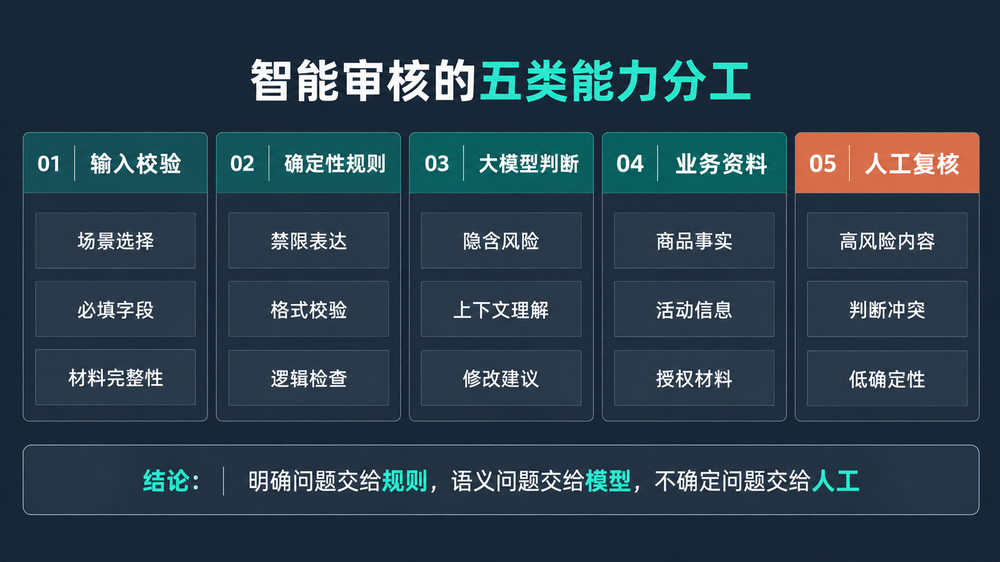

## 3. 为什么不能只接一个大模型

老师可以用同一条文案说明：

> “连续三年销量第一。”

只把这句话发给大模型，它可能认为表达有风险，也可能给出一段泛泛的解释。但产品真正需要的是：

- 命中的是哪类问题；
- 原文位置在哪里；
- 缺少的是统计范围、时间还是来源；
- 当前风险等级是什么；
- 是退回修改、补充材料还是转人工；
- 修改后是否要重新审核。

因此，大模型只是审核链路中的一个能力节点，不是整个产品。

## 4. 产品主流程

```text
运营选择审核场景并提交内容
            ↓
输入校验与材料完整性检查
            ↓
加载该场景启用的规则版本
            ↓
确定性规则检查 ＋ 大模型语义检查
            ↓
结果校验、合并、去重、定级
            ↓
通过 / 建议修改 / 退回修改 / 转人工
            ↓
运营修改或审核员处理
            ↓
重新审核并形成新版本
```

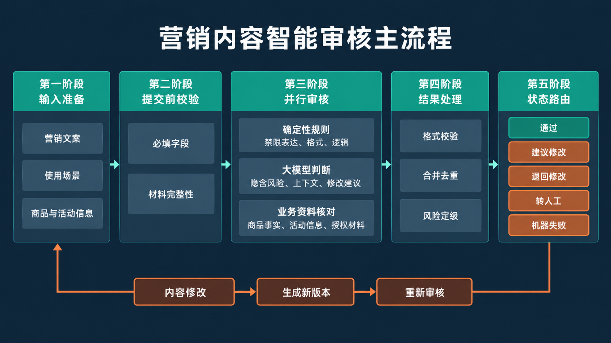

## 5. 第一版为什么使用 Workflow

本项目步骤明确，分支有限，处理要求可预先定义。使用 Workflow 更容易控制输入、输出、超时、重试和人工接管。Agent 可以在后续用于复杂材料收集或多轮追问，但不应成为第一版的必要条件。

## 6. 失败和不确定性怎么处理

| 情况 | 产品动作 |
|---|---|
| 必填上下文缺失 | 阻止提交，提示补充 |
| 模型超时 | 自动重试一次；仍失败则进入人工队列 |
| 输出格式校验失败 | 重新请求结构化输出；仍失败则标记机器失败 |
| 规则与模型结论冲突 | 保留两个原始结果，按高风险优先或转人工 |
| 内容已被运营修改 | 原审核结果标记为旧版本，必须重新审核 |

核心原则：机器失败不能默认通过，不确定结果不能伪装成确定结论。

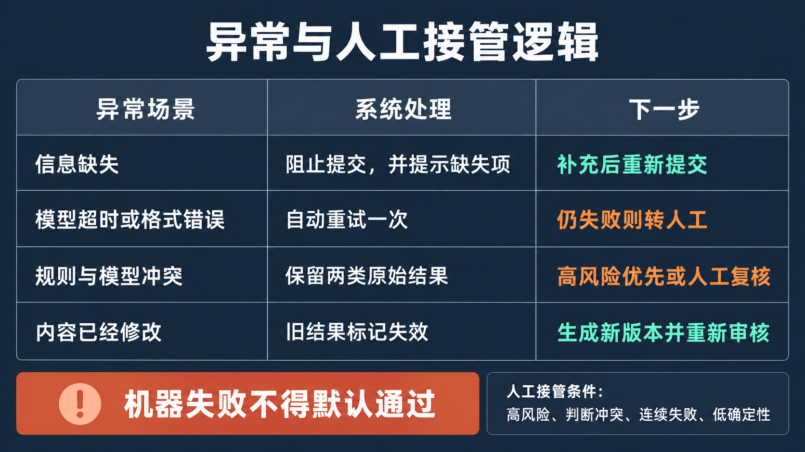

## 7. 本节收口

“AI 产品方案不是决定用哪个模型，而是设计一套分工机制。确定性问题交给规则，语义问题交给模型，事实核验依赖业务资料，最终责任和不确定问题交给人工。”

---

# 第三节：搭建规则系统与审核流程

## 1. 先把审核标准拆成可配置对象

营销审核常见的判断来源可以分为三层：

1. 外部通用要求；
2. 渠道和行业规则；
3. 公司内部品牌与商品口径。

产品不能把这些内容全部写进一个超长提示词。更可维护的做法是把它们拆成规则、场景和版本。

## 2. 本项目的规则分类

| 一级分类 | 检查内容 | 示例 |
|---|---|---|
| 基础质量 | 错别字、病句、信息缺失、格式问题 | 标点重复、商品名缺失 |
| 禁限表达 | 绝对化、保证性、极限性表达 | “100% 有效”“全网第一” |
| 商品事实一致性 | 文案是否与商品资料一致 | 成分、规格、功效、价格 |
| 来源与授权 | 排名、数据、专家、机构是否有材料支持 | “销量第一”“专家推荐” |
| 渠道与内部口径 | 特定平台或品牌要求 | 活动时间、免责声明、品牌禁用词 |

老师提示：这张分类表不是通用法规清单，而是本案例的产品分类。真实项目必须由业务、法务或审核负责人确认适用范围。

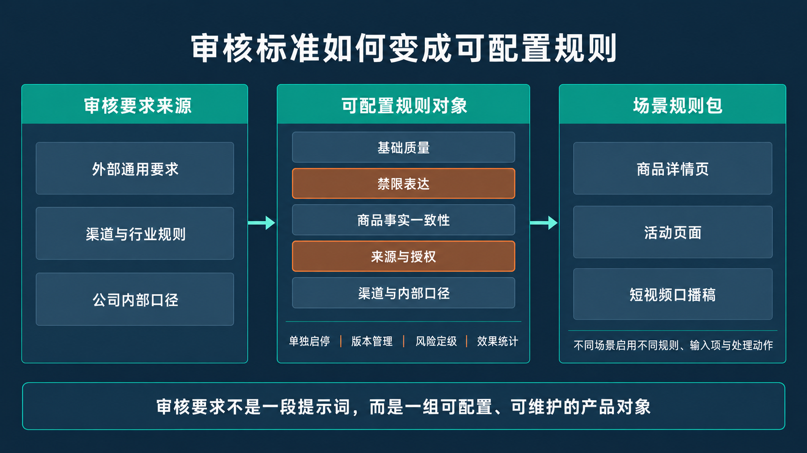

## 3. 一条原子规则应该包含什么

以“销量排名表达需补充范围和来源”为例：

| 字段 | 示例内容 |
|---|---|
| 规则编号 | R-SOURCE-003 |
| 规则名称 | 排名表达完整性检查 |
| 适用场景 | 商品详情页、活动页 |
| 触发条件 | 出现“第一、领先、TOP1”等排名表达 |
| 检查方式 | 关键词召回＋上下文语义判断＋材料字段核对 |
| 风险等级 | 中；材料缺失且影响较大时升为高 |
| 返回内容 | 原文片段、缺失项、处理建议、规则版本 |
| 处理动作 | 补充统计范围、时间和来源；无法补充则转人工 |

原子规则的价值是：能单独启停、测试、统计和迭代。规则越大，越难知道到底是哪一部分出了问题。

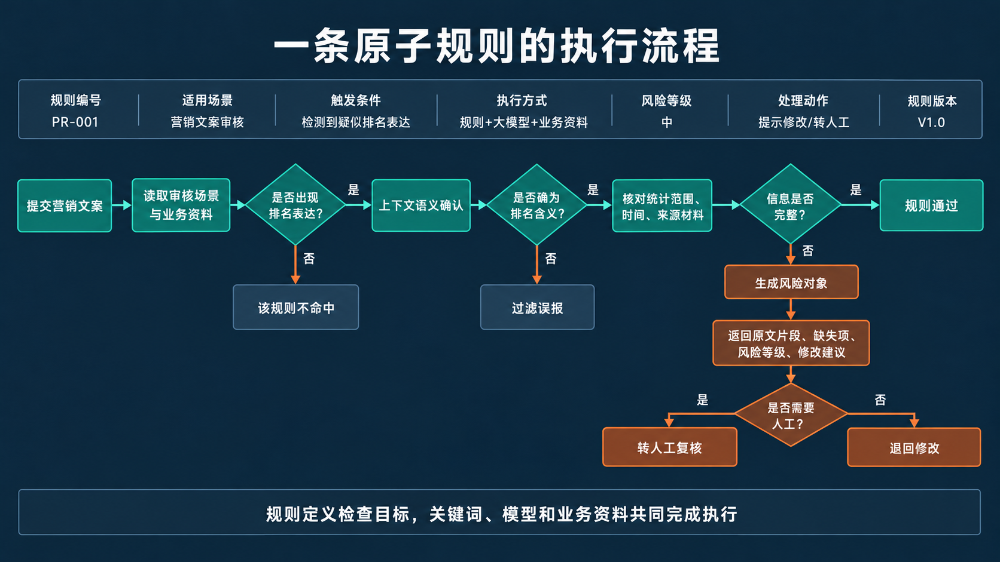

## 4. 场景配置

同一条规则不一定适用于所有内容。规则运营需要先建立“审核场景”，再为场景启用规则。

| 场景 | 重点规则 | 特殊输入 |
|---|---|---|
| 商品详情页 | 商品事实、禁限表达、来源材料 | 商品 ID、规格、商品资料 |
| 活动页 | 价格、时间、优惠条件、禁限表达 | 活动周期、优惠门槛 |
| 短视频口播稿 | 口语化夸大、功效暗示、授权 | 脚本版本、达人主体 |

第一版只实现前两个场景。口播稿作为后续扩展，用来说明系统设计为什么需要场景层。

## 5. 规则执行方式

一条审核规则可以由不同方式完成：

- **关键词**：适合快速召回明显表达。
- **正则或格式校验**：适合电话号码、价格格式、必填声明等。
- **确定性逻辑**：适合活动时间、价格范围、字段一致性。
- **大模型语义判断**：适合隐含承诺、上下文夸大和委婉表达。
- **外部数据核对**：适合商品信息、授权状态和报告有效期。

不要把“规则引擎”理解成只有关键词库。规则层定义的是业务检查项，执行层可以调用不同技术能力。

## 6. 用案例跑一遍规则

原文：

> 全网最值得买的胶原蛋白饮，7 天彻底改善熬夜暗沉，100% 有效。连续三年销量第一，三甲医院专家一致推荐。

可能形成四条风险对象：

| 原文片段 | 问题类型 | 等级 | 建议动作 |
|---|---|---|---|
| 全网最值得买 | 禁限表达 | 高 | 删除或改为可验证的产品描述 |
| 7 天彻底改善、100% 有效 | 保证性与功效表达 | 高 | 删除确定性承诺，按已确认口径改写 |
| 连续三年销量第一 | 来源与范围缺失 | 中 | 补充统计范围、时间和来源 |
| 三甲医院专家一致推荐 | 主体与授权不完整 | 高 | 补充明确主体和授权材料，否则删除 |

## 7. 结果为什么需要合并和去重

同一个片段可能同时被关键词规则和大模型命中。例如“100% 有效”可能得到两条结果。如果直接展示，运营会看到重复问题。

建议的合并逻辑：

1. 先按原文位置判断是否重叠；
2. 再按问题类型判断是否属于同一风险；
3. 同一风险保留较高等级；
4. 合并不同来源的说明；
5. 保留机器原始结果，前台只展示合并后的对象。

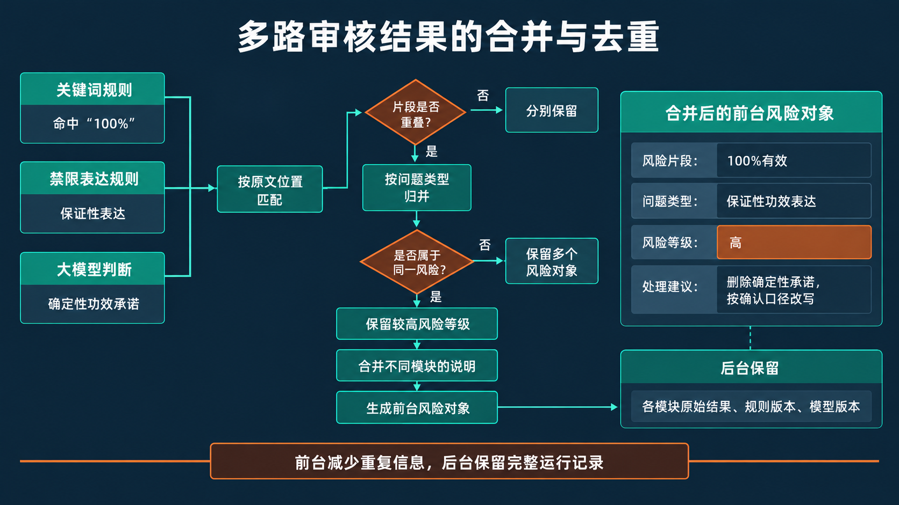

## 8. 整体状态与处理动作

| 整体状态 | 触发条件 | 下一步 |
|---|---|---|
| 机器预审通过 | 无有效风险，且检查完整 | 可进入后续业务流程 |
| 建议修改 | 只有低风险问题 | 运营可修改，也可按权限继续 |
| 退回修改 | 存在明确的中高风险问题 | 运营修改后重新提交 |
| 转人工复核 | 结论冲突、确定性不足或高风险规则要求 | 进入人工队列 |
| 机器失败 | 超时、格式错误、依赖不可用 | 重试或人工接管，不得默认通过 |

## 9. 状态流转

```text
草稿 → 审核中 → 机器预审通过
              ↘ 建议修改 → 修改后重审
              ↘ 退回修改 → 修改后重审
              ↘ 转人工 → 人工通过 / 驳回 / 升级
              ↘ 机器失败 → 重试 / 人工接管
```

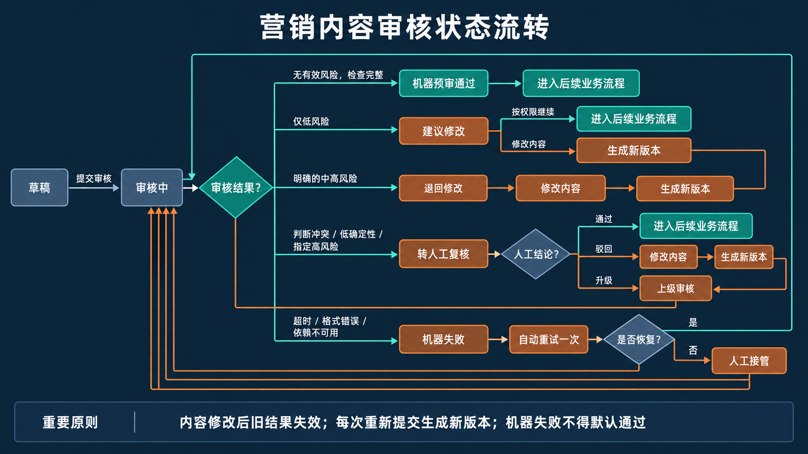

## 10. 课堂练习

给出句子：“我们不承诺 100% 有效，实际体验因人而异。”

请学员判断：只用关键词会发生什么？

老师收口：系统可能因为出现“100% 有效”而误报。解决办法不是简单删除关键词，而是让关键词负责召回，再由上下文判断确认；同时把这条样本加入回归测试集。

## 11. 本节收口

“产品经理不是把规则文档交给算法同学，而是把审核标准设计成可配置、可执行、可返回、可统计、可升级的产品对象。”

---

# 第四节：定义 MVP 与产品结构

## 1. MVP 要验证什么

第一版不是验证“模型能不能看懂文案”，而是验证三件事：

1. 混合审核能否稳定发现一批有价值的问题；
2. 结构化结果能否减少运营和审核员的重复沟通；
3. 机器不确定或失败时，人工是否能够安全接管。

## 2. MVP 功能清单

### P0：必须具备

- 场景选择与必要上下文输入；
- 文本提交和版本生成；
- 确定性规则检查；
- 大模型语义检查；
- 结构化结果校验、合并与定级；
- 原文定位和风险列表联动；
- 建议修改、退回修改、转人工和机器失败处理；
- 人工复核；
- 修改后重新审核；
- 基础操作记录与规则版本记录。

### P1：试点稳定后增加

- 规则运营后台；
- 批量任务；
- 数据看板；
- 更多渠道场景；
- 修改建议一键带入编辑区。

### 暂不进入

- 多模态审核；
- 自动发布；
- 自动覆盖原文；
- 面向全公司的复杂权限系统；
- 自主 Agent 审核。

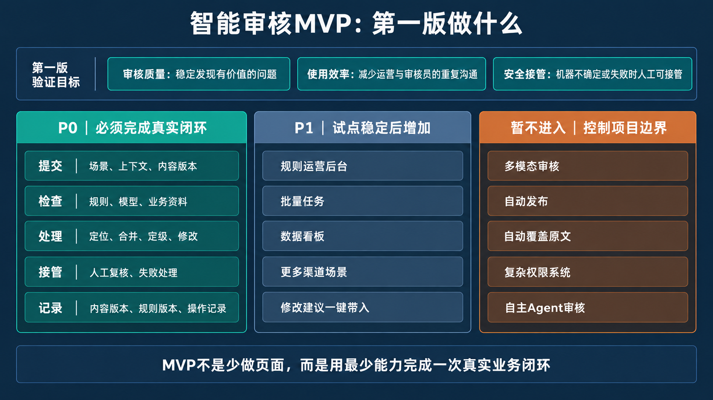

## 3. 三层产品结构

### 第一层：模型与数据来源

包含大模型、商品中心、活动信息、授权材料和当前业务口径。

### 第二层：审核能力层

包含输入解析、场景配置、原子规则、确定性检查、语义判断、结果合并和风险路由。

### 第三层：业务应用层

包含提交自查、流程审核、人工复核、历史任务和后续规则运营。

老师强调：架构图不是为了画得复杂，而是为了说清哪一层变化时会影响哪些产品模块。

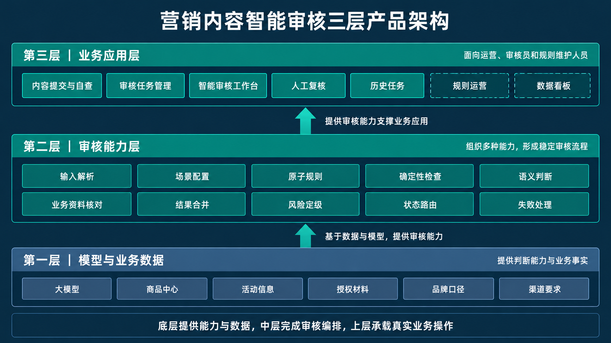

## 4. 核心数据对象

| 对象 | 关键字段 |
|---|---|
| 审核任务 | task_id、场景、提交人、状态、创建时间 |
| 内容版本 | version_id、原文、商品信息、活动信息 |
| 规则版本 | rule_set_id、启用规则、发布时间、适用范围 |
| 风险对象 | 原文位置、类型、等级、说明、建议动作、来源 |
| 人工结果 | 审核员、最终结论、调整原因、处理时间 |

内容一旦发生实质修改，就生成新版本。旧版本的结果不能直接沿用到新版本。

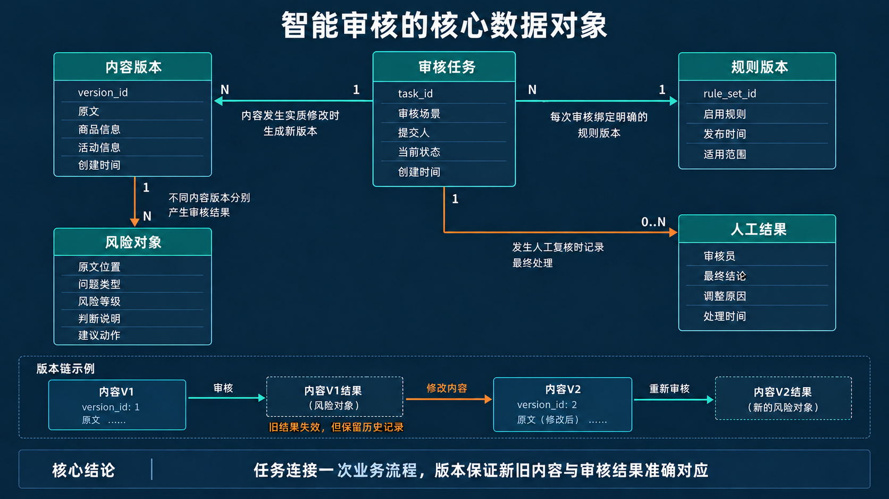

## 5. 关键异常

### 异常一：提交时材料不完整

产品在提交前提示缺少商品资料或活动条件。能补齐的先补齐；无法补齐但必须审核的，进入人工路径。

### 异常二：规则正在更新

每次审核绑定一个规则版本。规则发布后只影响新任务或重新审核任务，避免同一个任务在处理中途改变判断口径。

### 异常三：人工修改机器结论

系统同时保存机器原始结果和人工最终结果，并要求选择调整原因，供后续规则优化和回归测试使用。

## 6. 本节收口

“MVP 不是少画几个页面，而是用最少能力完成一次真实闭环。提交、检查、处理、人工接管、重新审核和记录，任何一个关键环节缺失，都只能算演示，不算可试点的产品。”

---

# 第五节：设计四个核心页面

## 1. 页面一：审核任务列表

### 页面目的

让运营和审核员快速找到待处理任务，并看懂当前状态。

### 关键信息

- 任务名称与编号；
- 审核场景；
- 提交人和提交时间；
- 当前版本；
- 风险数量与最高等级；
- 当前状态；
- 待处理人。

### 关键交互

- 按场景、状态、风险等级和提交人筛选；
- 运营默认看到自己的任务；
- 审核员默认优先看到高风险和等待时间较长的任务；
- 机器失败任务不能混在“通过”中。

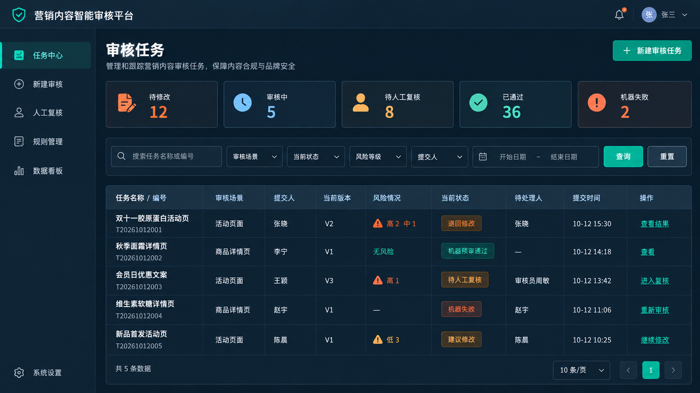

## 2. 页面二：内容提交页

### 页面结构

左侧填写业务上下文，右侧输入或粘贴正文。

### 必填内容

- 审核场景；
- 内容标题与正文；
- 商品或活动对象；
- 发布渠道；
- 必要的商品、价格或授权材料。

### 关键交互

- 切换场景时，动态显示该场景需要的字段；
- 提交前完成格式和必填校验；
- 明确提示“机器预审结果不代替最终业务判断”；
- 提交后生成不可覆盖的内容版本。

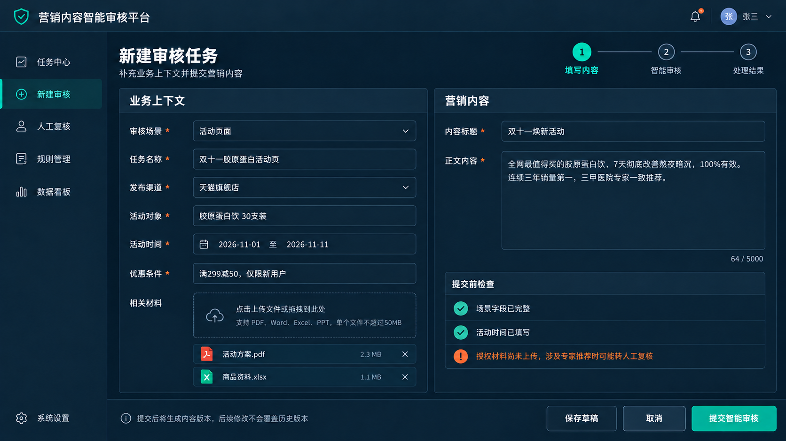

## 3. 页面三：智能审核工作台

这是整套产品最重要的页面。

### 推荐布局

- **左侧**：原始文案，风险片段高亮；
- **右侧**：风险列表，显示类型、等级、原因和建议动作；
- **顶部**：整体状态、风险统计、规则版本和重新审核入口；
- **底部或抽屉**：业务资料与处理记录。

### 关键交互

1. 点击右侧问题，左侧滚动并高亮对应片段；
2. 点击左侧片段，右侧定位到相应问题卡片；
3. 同一片段的重复结果只展示一个合并对象；
4. 修改正文后显示“内容已变化，需要重新审核”；
5. 修改建议可以复制或带入编辑区，但不能静默覆盖原文。

### 风险卡片至少展示

- 原文片段；
- 问题类型；
- 风险等级；
- 判断说明；
- 建议动作；
- 适用规则和版本；
- 是否需要人工复核。

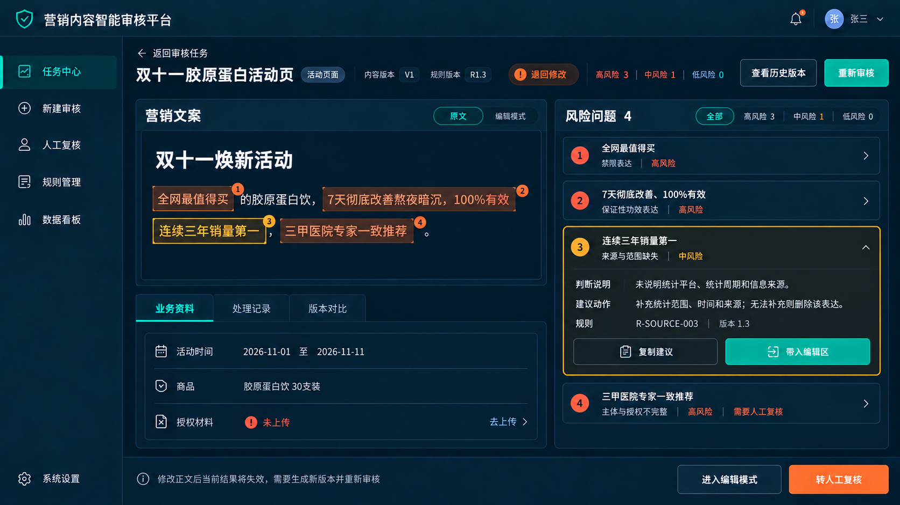

## 4. 页面四：人工复核页

### 审核员需要看到

- 原文及当前版本；
- 运营填写的上下文；
- 机器原始结果和合并后结果；
- 相关商品、活动与授权材料；
- 规则信息；
- 历史修改记录。

### 审核员可以执行

- 通过；
- 驳回修改；
- 调整问题类型或风险等级；
- 补充处理意见；
- 升级给更高权限人员。

人工调整机器结论时，应选择原因，例如“上下文补充后排除”“规则不适用”“机器遗漏”“风险等级不准确”。

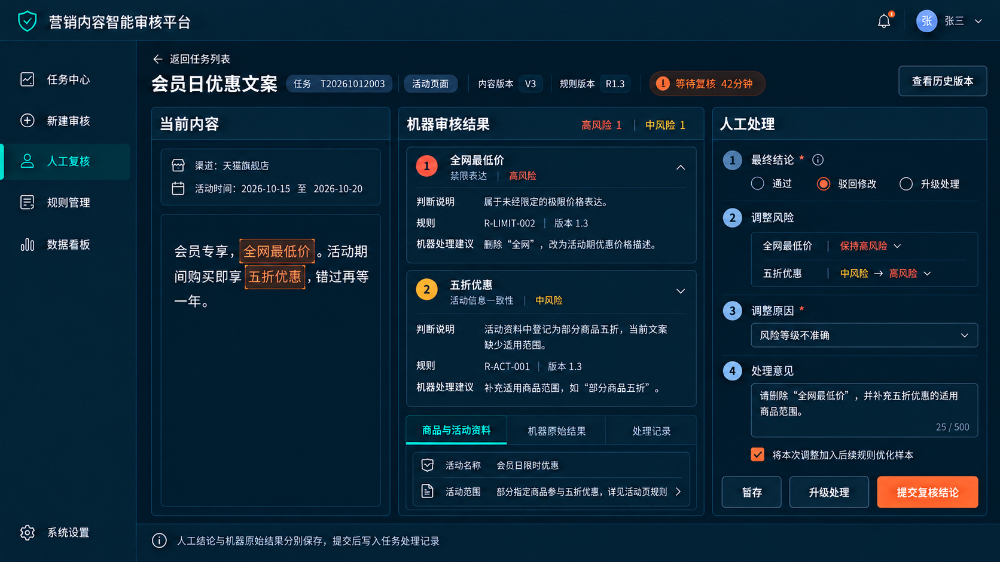

## 5. 产品页面的展示顺序

作品集中不要只放四张高保真图。更好的展示顺序是：

```text
业务流程
  ↓
产品主流程
  ↓
任务状态
  ↓
核心页面
  ↓
一个完整案例如何流转
```

这样页面设计和前面的业务判断能够对应起来。

## 6. 本节收口

“智能审核页面不是一块输入框加一段 AI 回复。它必须帮助用户定位、理解、处理和复核。页面形式服务于业务动作，而不是只展示模型能力。”

---

# 第六节：评测、坏案例与项目包装

## 1. 先建立评测样本

首版样本可以来自：

- 已脱敏的历史审核内容；
- 审核人员整理的典型案例；
- 围绕重点规则构造的边界样本；
- 已上线内容的抽检结果。

每条样本至少包含：

| 字段 | 说明 |
|---|---|
| 内容与场景 | 被审核文案及发布场景 |
| 必要上下文 | 商品、活动、渠道和材料信息 |
| 问题位置 | 应被标记的原文范围 |
| 问题类型与等级 | 期望分类和风险等级 |
| 期望动作 | 通过、修改、退回或转人工 |
| 标注人及版本 | 谁确认、按哪个规则版本确认 |

## 2. 指标怎么选

第一版至少观察四组指标：

1. **识别效果**：按问题类型分别看准确率、召回率和 F1，不只看总分。
2. **工程稳定性**：结构化输出成功率、超时率、依赖失败率。
3. **业务处理**：人工复核比例、平均处理时长、一次修改通过率。
4. **高风险表现**：严重漏检数量、人工调整机器高风险结论的比例。

课堂案例可以把“准确率不低于 90%、召回率不低于 85%、单篇两分钟内”作为试点讨论值，但必须说明：真实门槛要根据风险成本、样本分布和当前人工基线共同确定，不能照搬。

## 3. 三个典型坏案例

### 坏案例一：否定句误报

输入：“我们不承诺 100% 有效，实际体验因人而异。”

问题：关键词命中后直接判高风险，忽略否定关系。

改进：关键词负责召回，增加上下文语义确认；加入否定句、引用句和对比句样本。

### 坏案例二：上下文不足却强行下结论

输入：“连续三年销量第一。”

问题：系统不知道是否存在有效报告，却直接给出通过或违规结论。

改进：检查报告范围、时间和来源字段；缺失时返回“需补充材料”或转人工。

### 坏案例三：一个问题重复展示

输入：“全网第一，排名第一。”

问题：两条规则和模型产生多条高度重叠结果，运营不知道先处理哪一条。

改进：按位置、类型和语义相似度合并；保留最高等级和完整说明。

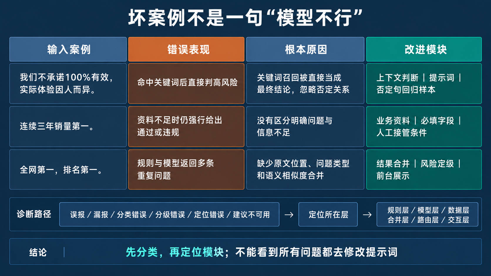

## 4. 迭代闭环

```text
线上任务
  ↓
机器结果与人工结果对比
  ↓
归类：误报 / 漏报 / 分级错误 / 定位错误 / 建议不可用
  ↓
决定修改：规则、提示、业务资料、结果合并或页面交互
  ↓
回归测试
  ↓
发布新规则版本
```

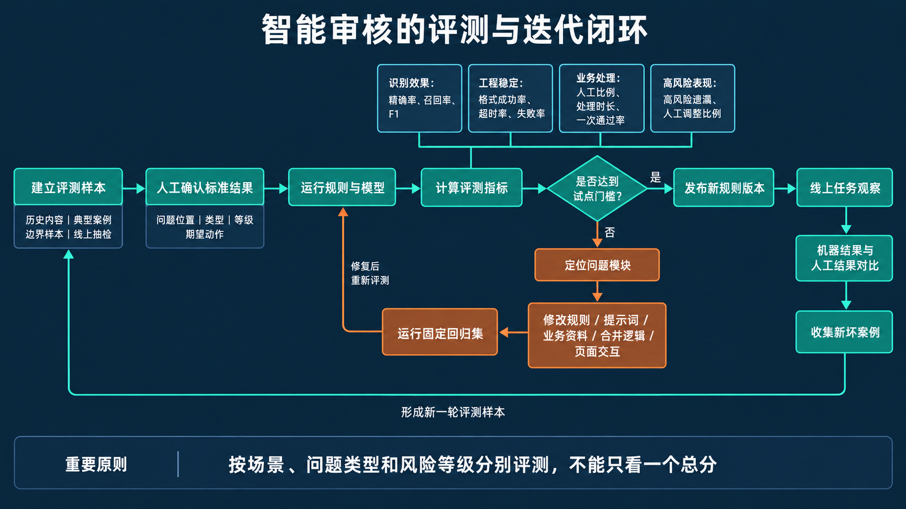

## 5. 作品集怎么呈现这个项目

建议用以下七部分：

1. **业务背景**：内容规模、原流程和主要断点。
2. **项目边界**：第一版做什么、不做什么，为什么。
3. **方案选择**：为什么采用规则＋大模型＋业务资料＋人工。
4. **产品设计**：主流程、规则系统、状态和四个核心页面。
5. **AI 设计**：输入、输出、能力边界和失败处理。
6. **测试迭代**：样本、指标、坏案例和修改动作。
7. **项目复盘**：已验证结论、仍待验证内容和下一版计划。

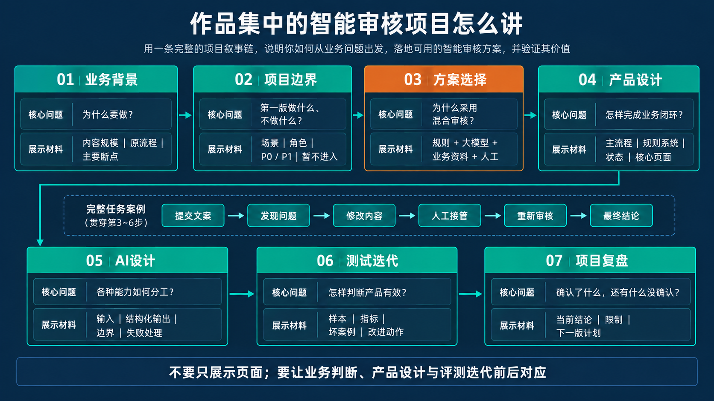

## 6. 面试时的一分钟讲法

> 我做的是一个面向电商营销文本的智能审核平台。原流程依赖人工逐篇检查，高峰期等待时间长，审核口径也不够稳定。第一版我没有追求多模态和自动发布，而是先限定商品详情页与活动文案两个场景。方案上采用确定性规则、大模型语义判断、业务资料核对和人工复核的混合流程。产品核心不是返回一段 AI 结论，而是把每个问题定位到原文，给出类型、等级和处理动作，并支持修改后重审与人工接管。项目评测除了准确率和召回率，也会看高风险漏检、人工复核比例和处理时长，通过坏案例持续更新规则和测试集。

## 7. 课后作业

### 必做

完成一份“营销内容智能审核项目包”，包含：

1. 一页业务现状与项目边界；
2. 一张混合审核主流程图；
3. 三条原子规则；
4. 一张智能审核工作台原型；
5. 十条测试样本，其中至少三条为边界样本；
6. 一页坏案例与改进方案。

### 进阶

把项目迁移到一个新行业，例如招聘信息审核、教育宣传审核或金融营销材料审核。必须重新定义角色、场景、规则分类、必要上下文和人工接管条件，不能只替换页面标题。

## 8. 全课结论

老师最后只强调三句话：

1. 智能审核不是一个模型调用，而是一条有人机分工的业务流程。
2. 规则、模型、业务资料和人工各自负责不同问题，不能相互替代。
3. 一个可落地的项目必须同时讲清输入、判断、处理、复核、失败和迭代。
